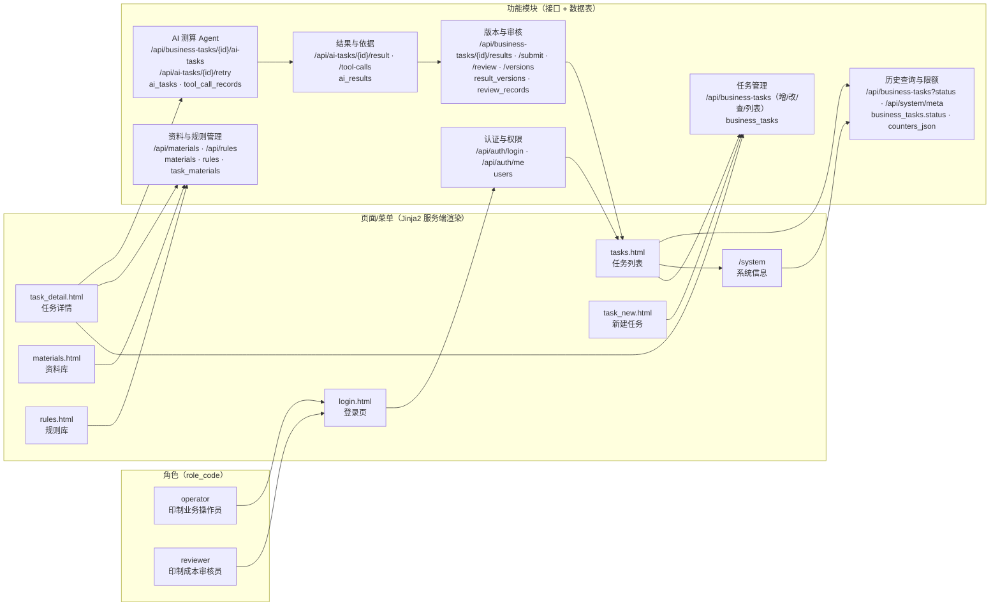

# 02 系统功能图（图1）

> 提交物②配套图 1 [原文 L79]；版本 `ARCH-v1.0`（与 [01 需求与设计说明](./01_需求与设计说明.md) 同版本号）。
> 画法：**角色 → 页面/菜单 → 功能模块 → 接口/表**，每个节点都能在程序里点到对应页面或接口；模块节点内直接标注该模块实现的接口与数据表 [清单 §9.1.1]。
> 口径：页面名以 `BUILD_SPEC.md` §7 为准（`login/tasks/task_new/task_detail/materials/rules/system`），接口与表名以 §4/§3 为准。

## 图1 系统功能图（mermaid 源，可直接复制到文档/PPT）

- 节点数：角色 2 + 页面 7 + 模块 7 = 16。【设计】清单建议"节点 ≤12"（[清单 §9.1.1]），本图因需同时承载"页面→模块→接口/表"三层映射而略有扩展，扩出的 4 个节点全部是真实页面（`task_new`/`materials`/`rules`/`system`），不引入程序里没有的功能。
- 若 PPT 版面紧张，可折叠为 11 节点精简版：删除 `P3/P5/P6` 三个页面节点（并入 `P4` 与 `F3`），保留角色 2、页面 4、模块 5。

## 1 页面与功能模块对照（教师任指一个节点都能点开）

| # | 页面/菜单 | 路由（HTML） | 功能模块 | 主要接口（24 个 REST 之一） | 数据表 | 对应 7 环节 [原文 L23] |
|---|---|---|---|---|---|---|
| 1 | 登录页 `login.html` | `GET /login`、`POST /login` | F1 认证与权限 | `POST /api/auth/login`、`GET /api/auth/me` | `users` | 进入系统（前置） |
| 2 | 任务列表 `tasks.html` | `GET /tasks` | F2 任务管理、F7 历史查询 | `GET /api/business-tasks` | `business_tasks`、`result_versions`（版本数列） | ⑦ 查询历史记录 |
| 3 | 新建任务 `task_new.html` | `GET /tasks/new`、`POST /tasks/create` | F2 任务管理 | `POST /api/business-tasks` | `business_tasks` | ① 创建任务 |
| 4 | 任务详情 `task_detail.html` | `GET /tasks/{id}` | F2/F3/F4/F5/F6 | 见下 4 个分组 | 见下 | ②-⑥ 全流程 |
| 5 | 资料库 `materials.html` | `GET /materials`、`POST /materials/create` | F3 资料与规则管理 | `GET/POST /api/materials`、`GET /api/materials/{id}`、`PATCH /api/materials/{id}`（启停） | `materials`、`task_materials` | ② 填写需求或导入数据 |
| 6 | 规则库 `rules.html` | `GET /rules`、`POST /rules/create` | F3 资料与规则管理 | `GET/POST /api/rules`、`GET /api/rules/{id}` | `rules` | ② 填写需求或导入数据 |
| 7 | 系统信息 `/system` | `GET /system` | F7 历史查询与限额 | `GET /api/system/meta` | —（读配置与限额） | ⑦ 查询（真实模式自证） |

### 任务详情页内的 4 个功能块（页面→接口的细化）

| 功能块 | 用户可见 | 调用接口 | 落库 |
|---|---|---|---|
| ② 参数与关联资料 | 参数表可编辑、关联资料列表 | `PUT /api/business-tasks/{id}`、`POST /api/business-tasks/{id}/materials` | `business_tasks.params_json`、`task_materials` |
| ③④ AI 运行区 + 结果区 | "运行 AI 测算"、状态徽标、测算说明、明细表、依据列表、不确定项/缺失项 | `POST /api/business-tasks/{id}/ai-tasks`、`GET /api/ai-tasks/{id}`、`GET /api/ai-tasks/{id}/result` | `ai_tasks`、`ai_results` |
| ③④ 执行记录表 | 每次工具调用一行（工具名/参数/摘要/来源 ID/状态/错误/耗时） | `GET /api/ai-tasks/{id}/tool-calls` | `tool_call_records` |
| ⑤⑥ 版本区 + 审核区 | 版本列表 v1/v2…、保存人工版本、提交审核、通过/退回 | `GET /api/business-tasks/{id}/versions`、`POST .../results`、`POST .../submit`、`POST .../review` | `result_versions`、`review_records`、`business_tasks.status` |

## 2 模块 → 接口清单（24 个，按模块归口）

| 模块 | 接口 | 小计 |
|---|---|---|
| F1 认证与权限 | `POST /auth/login`、`GET /auth/me` | 2 |
| F2 任务管理 | `POST /business-tasks`、`GET /business-tasks`、`GET /business-tasks/{id}`、`PUT /business-tasks/{id}`、`POST /business-tasks/{id}/materials` | 5 |
| F4 AI 测算 | `POST /business-tasks/{id}/ai-tasks`、`GET /ai-tasks/{id}`、`GET /ai-tasks/{id}/tool-calls`、`GET /ai-tasks/{id}/result`、`POST /ai-tasks/{id}/retry` | 5 |
| F3 资料与规则 | `GET/POST /materials`、`GET /materials/{id}`、`PATCH /materials/{id}`、`GET/POST /rules`、`GET /rules/{id}` | 7 |
| F6 版本与审核 | `POST /business-tasks/{id}/results`、`GET /business-tasks/{id}/versions`、`POST /business-tasks/{id}/submit`、`POST /business-tasks/{id}/review` | 4 |
| F7 系统与限额 | `GET /system/meta` | 1 |
| **合计** | 与 `BUILD_SPEC.md` §4 的 24 条逐条一致 | **24** |

## 3 图-程序一致性自检（图节点 ⇄ 代码/页面/表）

> 用途：教师抽查时按表逐行找对应物；改代码必须同步改图，图版本号统一 `ARCH-v1.0` [清单 §9.2]。

| 图节点 | 页面/代码位置 | 接口 | 数据表 | 核对结论（填 ✔/差异） |
|---|---|---|---|---|
| P1 登录页 | `app/templates/login.html`、`GET/POST /login` | `/api/auth/*` | `users` | 待核对 |
| P2 任务列表 | `app/templates/tasks.html`、`GET /tasks` | `/api/business-tasks` | `business_tasks` | 待核对 |
| P3 新建任务 | `app/templates/task_new.html`、`POST /tasks/create` | `POST /api/business-tasks` | `business_tasks` | 待核对 |
| P4 任务详情 | `app/templates/task_detail.html`、`GET /tasks/{id}` | 见 §1 细化表 | 5 张业务表 | 待核对 |
| P5 资料库 | `app/templates/materials.html` | `/api/materials*` | `materials`、`task_materials` | 待核对 |
| P6 规则库 | `app/templates/rules.html` | `/api/rules*` | `rules` | 待核对 |
| P7 系统信息 | `GET /system` | `GET /api/system/meta` | — | 待核对 |
| F4 Agent | `app/agent/orchestrator.py`、`app/api/ai.py` | `/api/business-tasks/{id}/ai-tasks`、`/api/ai-tasks/*` | `ai_tasks`、`tool_call_records` | 待核对 |
| F5 结果与依据 | `app/services/basis_service.py` | `/api/ai-tasks/{id}/result` | `ai_results` | 待核对 |
| F6 版本与审核 | `app/services/version_service.py`、`task_service.py` | `/results`、`/submit`、`/review` | `result_versions`、`review_records` | 待核对 |
| F7 限额 | `app/main.py` 页脚上下文、`GET /api/system/meta` | `/api/system/meta` | `ai_tasks.counters_json` | 待核对 |

## 4 图注与图例

- 实线箭头：调用/跳转关系（浏览器点击 → 页面 → 模块 → 接口）。
- `operator` / `reviewer`：两类角色，菜单与按钮按角色渲染，**后端仍逐接口校验** [表2 L27]。
- 模块节点内第一行为接口、第二行为所写数据表；表名与 [05 数据字典](./05_数据字典.md) 完全同名。
- 不在图内的能力（OCR、PDF 解析、微服务、多 Agent、消息队列）本系统**不实现**，见 [01 需求与设计说明](./01_需求与设计说明.md) §6.2。
