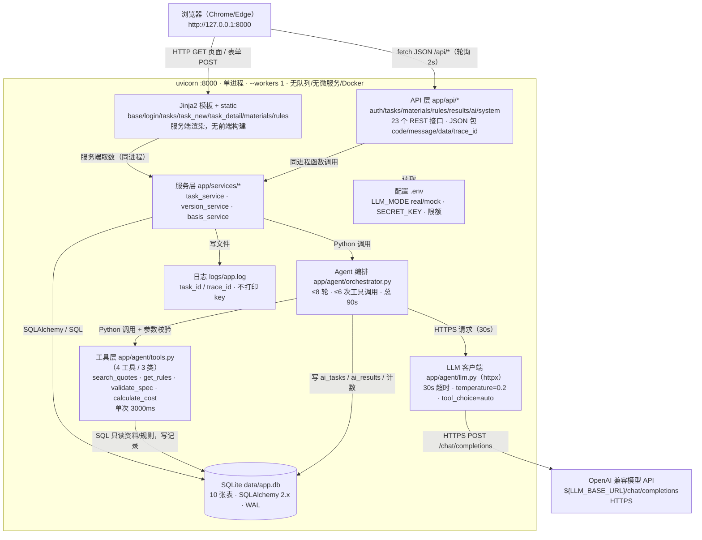
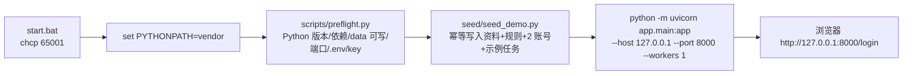
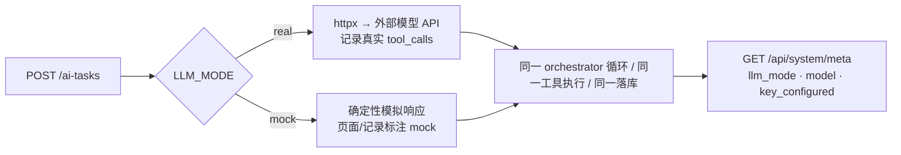

# 03 技术调用图（图2）

> 提交物②配套图 2 [原文 L79]；版本 `ARCH-v1.0`。
> 画法：**浏览器 → 进程 → 分层 → 外部依赖**，箭头标协议，节点标端口/超时/限额；与程序对应物逐一可查 [清单 §9.1.2]。
> 口径：`BUILD_SPEC.md` §1 目录、§2 环境变量、§4 接口、§6 Agent 实现、§8 运行与验收。

## 图2 技术调用图（mermaid 源，可直接复制到文档/PPT）

- 关键形态：**单体 + 单进程 + 单 worker**；静态文件、Jinja2 模板、REST 接口在同一 uvicorn 进程内；模型调用是唯一的出站网络依赖（HTTPS），无 Redis、无消息队列、无反向代理、无 Docker [原文 L36-L37]。
- 图中"23 个 REST 接口"与 `BUILD_SPEC.md` §4 一致；HTML 页面路由（登录/任务/资料/规则/系统）由同一进程的页面路由提供，不占 23 个编号【设计】。

## 1 调用链分解（协议 / 端口 / 超时 / 代码位置）

| # | 调用链 | 协议/形态 | 端口 | 超时/限额 | 代码位置 |
|---|---|---|---|---|---|
| 1 | 浏览器 → 页面路由 | HTTP GET/POST 表单（`x-www-form-urlencoded`） | 8000 | — | `app/main.py` + `app/templates/*.html` |
| 2 | 浏览器 → REST 接口 | HTTP JSON（`fetch`，AI 状态轮询 2s） | 8000 | 前端 90s 停轮询 | `app/api/*.py`、`app/static/app.js` |
| 3 | 页面路由/接口 → 服务层 | 同进程函数调用 | 进程内 | — | `app/services/*.py` |
| 4 | 服务层 → Agent 编排 | 同进程调用（后台线程 `daemon=True`） | 进程内 | 总 `AI_RUN_TIMEOUT_S=90` | `app/agent/orchestrator.py` |
| 5 | Agent → 模型 | HTTPS POST `${LLM_BASE_URL}/chat/completions`，Bearer key | 出站 443 | `LLM_TIMEOUT_S=30`、≤8 轮、`temperature=0.2` | `app/agent/llm.py` |
| 6 | Agent → 工具层 | Python 调用 + JSON Schema/pydantic 参数校验 | 进程内 | `TOOL_TIMEOUT_MS=3000`、≤6 次 | `app/agent/tools.py` |
| 7 | 工具层 → SQLite | SQL（SQLAlchemy 2.x，每线程新 Session） | 本地文件 | — | `app/db.py`、`app/models.py` |
| 8 | 服务层 → SQLite | SQL | 本地文件 | — | `app/services/*.py` |
| 9 | 进程 → 日志/配置 | 文件 IO（`logs/app.log`、`.env`） | — | key 掩码 | `app/config.py`、日志配置 |

## 2 启动与就绪链（`start.bat`）

- preflight 检查项：Python 版本、`vendor/` 依赖可 import、`data/` 可写、8000 端口占用、`.env` 存在、`LLM_MODE=real` 且 key 为空时告警 [原文 L83]。
- 种子幂等：已存在则跳过，可重复执行；两账号 `operator/123456`、`reviewer/123456`；含 1 条演示任务。

## 3 真实 / 模拟双模切换（验收固定 real）

- `GET /api/system/meta` 返回 `llm_mode`、`model`、`key_configured`、`limits{6/8/30/3000/90/10}`、`server_time`，是现场"真实调用自证"的第一屏 [原文 L63]。
- 模拟响应仅用于无 key 开发，且必须在页面与记录中标注；**mock 不作为验收兜底** [原文 L63]。

## 4 限额速查（图中数字的唯一来源）

| 常量 | 值 | 生效位置 |
|---|---|---|
| `MAX_TOOL_CALLS` | 6 次/任务 | Agent 循环计数，超限停止并回填提示 |
| `MAX_LLM_ROUNDS` | 8 轮/任务 | 每次模型往返计 1 轮 |
| `LLM_TIMEOUT_S` | 30 s | 单次模型 HTTP 请求 |
| `TOOL_TIMEOUT_MS` | 3000 ms | 单次工具执行（超时 → `TOOL_TIMEOUT`） |
| `AI_RUN_TIMEOUT_S` | 90 s | 整体运行；页面轮询 90s 后提示 |
| `MAX_AI_RUNS` | 10 次/任务 | 重试上限，超限 429 |

## 5 与程序的对应物核查

| 图节点 | 程序文件 | 核查方式 | 结论 |
|---|---|---|---|
| 页面（Jinja2） | `app/templates/base.html` 等 7 个模板 + `app/static/style.css` 与 `app.js` | 打开 `GET /login`、`/tasks` | 待核对 |
| API 层 | `app/api/{auth,tasks,materials,rules,results,ai,system}.py` | `grep -rn "@router" app/api` 计 23 条 | 待核对 |
| 服务层 | `app/services/{task,version,basis}_service.py` | 阅读调用点 | 待核对 |
| Agent | `app/agent/{orchestrator,llm,tools,prompts}.py` | 跑一次任务看轮次/计数 | 待核对 |
| 工具层 | `app/agent/tools.py` 注册表 4 个工具 | `python -c` 打印注册名 | 待核对 |
| SQLite | `data/app.db`（`app/db.py`、`app/models.py`） | `sqlite3 .tables` 应 10 张 | 待核对 |
| 模型 API | `.env` 的 `LLM_BASE_URL/LLM_MODEL/LLM_API_KEY` | `GET /api/system/meta` | 待核对 |

## 6 图注

- 实线：同步调用；图中未画 Redis/队列/网关，因为**不存在**。
- 所有出站流量仅一条：`LLM_BASE_URL`（HTTPS）；其余均为本地进程内或本地文件/SQLite。
- 端口 8000、单 worker 是演示口径；`--reload` 仅开发期可选，演示用 `start.bat` 固定单进程 [原文 L83]。
