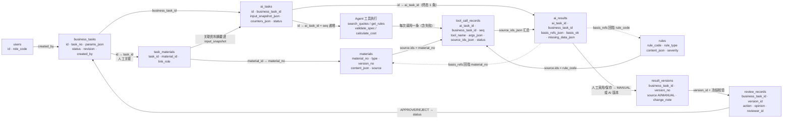

# 04 数据处理与工具执行图（图3）

> **HTML 演示版**：`docs/三张图演示.html`（离线单文件，浏览器直接打开；系统启动后也可访问 http://127.0.0.1:8000/diagrams ）

> 提交物②配套图 3 [原文 L79]；版本 `ARCH-v1.0`。
> 画法：**表 × ID 流转**，每条边标注流转的关键字段；10 张表与 `BUILD_SPEC.md` §3、[05 数据字典](./05_数据字典.md) 同名 [清单 §9.1.3]。
> 核心口径：工具调用与业务结果**使用同一业务任务 ID** [原文 L49]；依据存在 `ai_results.basis_refs_json`，来源锚点存在 `tool_call_records.source_ids_json`。

## 图3 数据处理与工具执行图（mermaid 源，可直接复制到文档/PPT）



- 节点数：10 张表 + 1 个执行节点 = 11（清单建议 ≤12）。
- 所有业务表都以 `business_task_id`（`task_materials` 中列名为 `task_id`）为**同一主键贯通**：`business_tasks.id` = `ai_tasks.business_task_id` = `tool_call_records.business_task_id` = `ai_results.business_task_id` = `result_versions.business_task_id` = `review_records.business_task_id`。
- `tool_call_records` 额外带 `ai_task_id`：既能按任务聚合，也能按单次 AI 运行聚合（重试后旧记录仍可查）。

## 1 一次完整运行的 ID 流转（正常完成）

| 步 | 动作 | 写入表 | 关键字段 | 产生/传递的 ID |
|---|---|---|---|---|
| 1 | 操作员建任务 | `business_tasks` | `task_no`、`params_json`、`status=PENDING`、`revision=1`、`created_by` | `business_task_id`（主 ID） |
| 2 | 关联纸张报价 | `task_materials` | `task_id`、`material_id`、`link_role=paper` | `material_id` → `materials.material_no`（规则由 `get_rules` 按 `business_type` 读取，不入关联表） |
| 3 | 点"运行 AI 测算" | `ai_tasks` | `business_task_id`、`status=PENDING→RUNNING`、`input_snapshot_json`（参数+资料+规则摘要）、`model_mode` | `ai_task_id` |
| 4 | 模型第 1 轮选工具 | `tool_call_records` | `ai_task_id`、`business_task_id`、`seq=1`、`tool_name=search_quotes`、`args_json`、`source_ids_json=[material_no…]`、`status=SUCCESS`、`latency_ms` | `source.ids` 首次落地 |
| 5 | 模型第 2 轮选工具 | `tool_call_records` | `seq=2`、`validate_spec`、`source_ids_json=[rule_code…]` | 第 2 类工具（retrieval + validation） |
| 6 | 模型第 3 轮选工具 | `tool_call_records` | `seq=3`、`calculate_cost`、`status=SUCCESS`、`result_summary`（≤200 字） | 第 3 类工具（calculation） |
| 7 | 模型给 final JSON | `ai_results` | `ai_task_id`、`business_task_id`、`content_md`、`structured_json`、`basis_refs_json`、`basis_ok=1`、`uncertain_items_json`、`missing_data_json` | 结果 1 条 |
| 8 | 任务终态 | `ai_tasks` | `status=SUCCEEDED`、`counters_json{rounds,tool_calls,distinct_types,model_calls}`、`finished_at` | 计数落库 |
| 9 | 人工修改后保存 | `result_versions` | `business_task_id`、`version_no=1`（AI 采用）→ `2`（MANUAL）、`source`、`change_note`、`created_by` | `version_id` |
| 10 | 提交审核 | `business_tasks` | `status=PENDING_REVIEW`；目标版本冻结 | `version_no` |
| 11 | 审核通过/退回 | `review_records` | `business_task_id`、`version_id`、`action=APPROVE/REJECT`、`opinion`、`reviewer_id` | 回写 `status=COMPLETED/REJECTED` |
| 12 | 历史查询 | —（只读） | 按 `business_task_id` 联查：详情 / 版本 / 执行记录 / 结果 | 全链路可回查 |

## 2 三种运行结局的落库差异（对应 [表4] 现场 4 场景）

| 结局 | `ai_tasks.status` | `error_code` | `tool_call_records` | `ai_results` | 能否提交审核 |
|---|---|---|---|---|---|
| 正常完成 | `SUCCEEDED` | 空 | ≥2 类工具 SUCCESS，`source_ids_json` 非空 | 1 条，`basis_ok=1`，`missing_data=[]` | 可以 |
| 数据不足（如实报缺） | `SUCCEEDED` | 空 | 检索/计算返回 `ok=false, DATA_NOT_FOUND`，`status=FAILED`，`data.missing[]` 记录缺失单价 | 1 条，`missing_data` 非空，`structured.total=null` | 可以（须补齐缺失项或注明；若 `basis_ok=0` 则按 T06 口径 409 阻止） |
| 数据不足仍编造 total | `FAILED` | `DATA_FABRICATED` | 调用记录保留 | 不写 `ai_results`（或标记不可用） | 不可以 |
| 工具参数错误 | 视护栏：可恢复则 `SUCCEEDED`；不足 2 类成功则 `FAILED` | `TOOL_ARGS_INVALID` / `NO_TOOL_CALL` | 该次 `status=FAILED, error_code=TOOL_ARGS_INVALID`，参数原文留 `args_json` | 成功才写 | 视终态 |
| 工具超时 | `FAILED` | `TOOL_TIMEOUT` | 该次 `status=FAILED, error_code=TOOL_TIMEOUT, latency_ms≈3000` | 不写 | 不可以（可重试） |
| 依据不一致（T06） | `SUCCEEDED` | 空 | 记录正常 | 1 条，`basis_ok=0`，`uncertain_items` 追记"依据不一致/依据已变更" | **被阻止**（409 `BASIS_MISMATCH`）【设计】 |
| 进程重启残留 | `FAILED` | `STALE_RUNNING` | 保留已发生的调用 | 不写 | 可以重试 |

> 说明：`basis_ok=0` 是"结果可用性"问题，**不是 AI 任务失败**；按 [清单 §11.3] 的唯一口径，只做标记并阻止确认，不把 `ai_tasks` 置为 FAILED。

## 3 同一 task_id 贯通核对（现场可执行的只读 SQL）

```sql
-- 全部子表都能按同一业务任务 ID 聚齐（sqlite3 data/app.db）
SELECT 'task'      AS src, id AS rid, task_no AS ref  FROM business_tasks WHERE id = :task_id
UNION ALL SELECT 'material',   material_id, link_role  FROM task_materials    WHERE task_id = :task_id
UNION ALL SELECT 'ai_task',    id,          status      FROM ai_tasks          WHERE business_task_id = :task_id
UNION ALL SELECT 'tool_call',  id,          tool_name   FROM tool_call_records WHERE business_task_id = :task_id
UNION ALL SELECT 'result',     id,          basis_ok    FROM ai_results        WHERE business_task_id = :task_id
UNION ALL SELECT 'version',    id,          version_no  FROM result_versions   WHERE business_task_id = :task_id
UNION ALL SELECT 'review',     id,          action      FROM review_records    WHERE business_task_id = :task_id;
```

- 预期：`ai_task`、`tool_call`（≥2 条且 ≥2 类）、`result`、`version`（≥2）、`review`（≥1）都能按同一个 `:task_id` 查到 [原文 L49]。
- 页面等价操作：任务详情页 → 执行记录区 → 结果区 → 版本区 → 审核区，任意区块都可跳回同一任务。

## 4 依据三跳在表上的落点

| 跳 | 页面/接口 | 读取字段 | 证明什么 |
|---|---|---|---|
| 第 1 跳 | 结果区依据列表 `GET /api/ai-tasks/{id}/result` | `ai_results.basis_refs_json[{type,id,label}]` | 结果声明用了哪些依据 |
| 第 2 跳 | 资料/规则详情 `GET /api/materials/{id}`、`GET /api/rules/{id}` | `materials.source/version_no/content_json`、`rules.source/content_json` | 依据真实存在、来源与版本可见 |
| 第 3 跳 | 执行记录 `GET /api/ai-tasks/{id}/tool-calls` | `tool_call_records.args_json`、`source_ids_json`、`latency_ms`、`status` | 这条依据是**本次**工具实际取到的，不是模型编的 |

## 5 数据流与合规约束

- 写入方：仅后端（API/服务层/Agent 执行器）。前端只读展示，模型只产出 JSON 文本，**不能直接写库**；`tool_call_records` 由执行器逐条写入 [表2 L31]。
- 只读方：工具对 `materials`/`rules` 只做 SELECT，不改业务数据；改价只能通过资料新增/版本化完成【设计】。
- 模拟数据：`materials.source` 标注"教学模拟/自编"，页面角标"模拟数据·仅教学演示"，不把模拟结果当真实业务数据 [原文 L61]。
- 冻结规则：`result_versions` 只增不改，已提交/已通过版本被修改 → 409；`UNIQUE(business_task_id, version_no)` 防重号。
- 幂等与并发：同一任务并发启动 AI 受任务状态 + `MAX_AI_RUNS=10` 约束；重复提交审核按 409/幂等处理（见 [06 测试用例](./06_测试用例.md) TC08）。

## 6 图注

- 实线：写入/传递；虚线：`basis_refs` 回指关系（结果声明依据 → 资料/规则主数据）。
- `source.ids` 是依据校验的锚点：`basis_refs.id` 必须落在"本次 `source.ids` ∪ 任务关联 `material_no` ∪ `rule_code` ∪ 参数业务数据"内，否则 `basis_ok=false`。
- 表名、字段名与 [05 数据字典](./05_数据字典.md) 逐字一致；改表必须同步改本图并升版本号。
